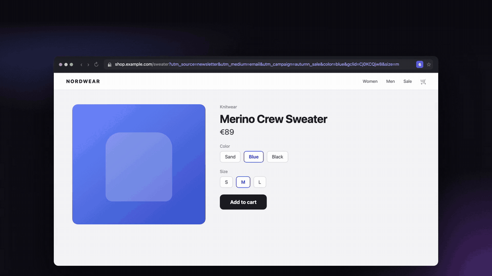

<div align="center">


# Paramlet

View, edit and save the query parameters of the current page.

[](https://addons.mozilla.org/firefox/addon/paramlet/)
[](https://github.com/Arifdamar/paramlet/releases/latest)

[](https://github.com/Arifdamar/paramlet/actions/workflows/ci.yml)
[](https://github.com/Arifdamar/paramlet/releases/latest)
[](LICENSE)



[Watch the full demo video](docs/paramlet-demo.mp4)

</div>

## Features

- Shows the number of query parameters on every page and opens them as an
  editable list
- Edit, add and remove parameters, then apply the result or copy the URL
- Only the parameters you change are rewritten; the rest of the URL keeps its
  original encoding, repeated keys and empty segments
- One click removal of tracking parameters (`utm_*`, `gclid`, `fbclid` and
  [more](src/tracking.js))
- Parameters after `#` in single-page app URLs (`#/orders?page=3`)
- Paste a URL, a query string or `key=value` lines to add many parameters at
  once
- Presets: save parameters per site or for all sites, apply them with
  <kbd>1</kbd> to <kbd>9</kbd>, reorder by dragging
- Search for long lists
- Settings page to manage, export and import presets
- English and Turkish

## Supported browsers

| Browser | Where the button is |
|---|---|
| Firefox, Zen and other Firefox based browsers | Inside the address bar |
| Chrome, Edge, Brave, Opera | Toolbar (pin it from the extensions menu) |

Chromium browsers do not allow extension buttons inside the address bar, so
there the button lives in the toolbar. Everything else works the same.

## Installation

### Firefox and Zen

Install from [Firefox Add-ons](https://addons.mozilla.org/firefox/addon/paramlet/).

### Chrome, Edge, Brave and Opera

Store listings are on the way. Until then:

1. Download `paramlet-<version>-chromium.zip` from the
   [latest release](https://github.com/Arifdamar/paramlet/releases/latest)
   and unzip it.
2. Open `chrome://extensions` (`edge://extensions` in Edge) and turn on
   **Developer mode**.
3. Click **Load unpacked** and select the unzipped folder.

## Usage

Click the Paramlet button or press the shortcut to open the panel. Edit the
list, then press **Apply** or <kbd>Enter</kbd>.

| Shortcut | Action |
|---|---|
| <kbd>Alt</kbd>+<kbd>Q</kbd> (<kbd>Ctrl</kbd>+<kbd>Q</kbd> on macOS) | Open the panel |
| <kbd>Enter</kbd> | Apply changes |
| <kbd>Ctrl</kbd>/<kbd>⌘</kbd>+<kbd>Enter</kbd> or click | Apply in a new tab |
| <kbd>1</kbd> to <kbd>9</kbd> | Apply a preset |
| <kbd>/</kbd> | Search |
| <kbd>Alt</kbd>+<kbd>↑</kbd> / <kbd>Alt</kbd>+<kbd>↓</kbd> | Move the focused preset |

The panel shortcut can be changed on the settings page.

### Presets

Click **Save preset**, untick the parameters you don't want, give it a name
and save. Tick **All sites** to use it on every site. Applying a preset sets
its values, adds missing keys and leaves the other parameters alone.

`www.example.com` and `example.com` share presets. Subdomains and ports have
their own. Presets are stored in the browser's sync storage.

## Privacy

Paramlet makes no network requests and collects no data.

| Permission | Used for |
|---|---|
| `tabs` | Reading the current URL and loading the edited one |
| `storage` | Saving presets |

## Development

Requires Node.js 22 or newer.

```sh
npm install
npm test                # unit tests
npm run lint            # web-ext lint (Firefox)
npm start               # run in Firefox with the extension loaded
npm run build           # Firefox and Chromium zips in web-ext-artifacts/
npm run build:chromium  # Chromium build only, unpacked in dist/chromium/
```

Run in Zen on macOS:

```sh
npm start -- --firefox="/Applications/Zen Browser.app/Contents/MacOS/zen"
```

`manifest.json` targets Firefox. `scripts/chromium-manifest.mjs` generates the
Chromium manifest from it at build time.

```
src/
  query.js        URL parsing and rebuilding
  presets.js      preset storage, site matching, export and import
  tracking.js     tracking parameter list
  sortable.js     drag to reorder
  popup/          the panel
  options/        the settings page
_locales/         translations
scripts/          Chromium build
test/             unit tests
```

Pushing a `v*` tag builds both packages and publishes a GitHub release.

## Contributing

Issues and pull requests are welcome. To add a translation, copy
`_locales/en/messages.json` to `_locales/<language>/messages.json` and
translate the `message` values. `npm test` checks that no key is missing.

## License

[MIT](LICENSE)
